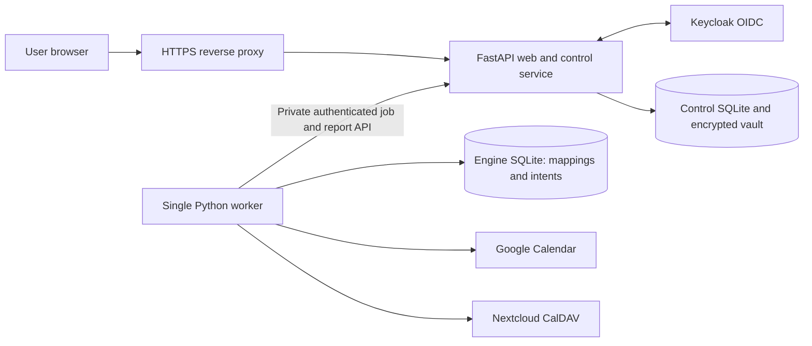

# Multi-user web application and worker design

Issue #17; proposed implementation contract, reviewed against provider documentation on 2026-11-16. This PR adds design only. No web route, SSO, schema migration, credential broker, calendar discovery or reverse write exists in this revision. The merged v0.1.0 worker remains one-way, one explicit pair per process; its artifact is unchanged. Source merge is not proof that a release tag was published.

## Product flow and delivery boundary

Users sign in with Keycloak, connect Google and Nextcloud, select one-to-one calendar pairs, review a complete preview and enable background synchronization. Each user can have multiple pairs. Closing the browser does not stop an enabled pair. Initial connection/reauthorization uses the user's browser; the Linux Docker server and ongoing worker are headless. No Windows Python, Java helper, token download or manual token transfer is needed in the future web flow. Existing Desktop authorization remains the v0.1.0 deployment procedure until this feature ships.

M4 first delivers Google-to-Nextcloud ordinary-event synchronization across user-owned pairs. M5 adds explicitly enabled two-way ordinary events only after #20/#38 acceptance. Recurrence (#21), deletion propagation, invitations and automatic conflict winners remain unavailable. The UI must display unsupported capability rather than offer an inert two-way switch. Keycloak application login does not grant Google or CalDAV access.

## Components and state ownership

The web service owns a **new control database**, sessions, provider connection flows, job commands and a redacted read model. It never opens the engine StateStore, calls preview_sync in a request or performs event writes. Provider authorization/discovery are queued connector work; OAuth code exchange and Nextcloud flow polling run in a bounded connection service, not in event-write handlers. Services communicate through explicit interfaces, not raw SQL from routes.

One worker process owns the engine database and its existing lifetime lock. It serializes pairs initially, using bounded per-pair work and round-robin scheduling, per-connection cooldown and per-pair failure isolation. No Uvicorn process starts an embedded worker. Deployment has one web process and one worker replica initially; scale-out, shared/network SQLite and high availability are excluded. The new control store uses its own transactional repository and does not reuse StateStore's lifetime locking model. Persist both stores and the vault recovery key separately; no browser-facing database port.

The worker pulls revision-bound commands over an authenticated private service endpoint and posts redacted results. Use a distinct service credential mounted outside images, constant-time credential verification and encrypted transport (mTLS for service identity); browser session cookies cannot authenticate worker endpoints. The reverse proxy does not publish /internal routes. Internal endpoints still authorize the worker's deployment identity, job assignment, lease and configuration revision; internal networking alone is not authentication. Bootstrap certificates/credentials are an operator task before enabling this deployment.

### Service interfaces

Proposed Python boundaries, not implemented classes: OwnerContext contains validated issuer/subject/roles and resolved owner_id; route code cannot construct it from request JSON. ConnectionRepository and PairRepository require that context for every list/get/mutate operation and perform transactional revision/ownership checks. PairService validates selected discovery generations and reserves endpoints; it emits commands instead of calling adapters. JobRepository owns outbox/lease/report transitions. SecretBroker accepts either an owner-bound connection operation or an authenticated assigned worker job, never a raw path from a caller. HistoryRepository reads only the sanitized control projection.

Connector interfaces return complete DiscoverySnapshot records with canonical identity, capabilities, generation and expiry. GoogleCredentialProvider supplies access_token() and serializes refresh/version updates through SecretBroker; CalDAVCredentialProvider supplies the assigned connection's credentials in memory. Implement adapter injection rather than writing general temporary secret files or teaching the existing strict Desktop parser to accept arbitrary Web scopes. Routes depend on services/repositories; provider normalization/planning/execution remain in the engine. Changes to those interfaces require their own fake-provider tests in #35/#36.

### Durable scheduling contract

The control service transactionally changes pair state and inserts an outbox command with a unique command ID, pair ID, owner ID, revision, mode and idempotency key. Delivery is at least once. Commands have pending/leased/completed/failed/cancelled states, bounded attempts and a lease expiry; one active command per pair. A retry with the same key/body returns the existing command, while a different body with that key returns 409. Polling and explicit sync-now requests coalesce rather than enqueue unbounded duplicate jobs.

The worker validates ownership, connection status, pair revision and lease before starting and before each mutation; inability to validate stops new writes. It persists job identity/results alongside execution recovery before reporting. Report loss does not authorize replaying writes: recover durable engine intents and replay the idempotent result. Control-store failure after remote success is a pending report, not a new create. A lease is not remote-write fencing: a replacement worker must acquire the same engine lifetime lock after the old process exits. Never force-unlock or start a second engine to work around an expired lease.

Pause/revoke is asynchronous: stop new work, prevent subsequent mutations on recheck, and drain any already-issued provider request. The UI reports pausing until worker acknowledgement; it must not promise an in-flight write was cancelled. Activation after changes requires a new preview. Logout ends the web session but does not revoke provider grants or pause explicitly enabled pairs. Connection revocation pauses dependent pairs; local disconnect does not silently revoke other apps or shared grants at Google.

Job results/read models are eventually consistent and include last_reported_at, mode, pair revision, counts and sanitized reason codes. Never show last-cycle healthy as process liveness. Expose worker heartbeat separately and show stale reports as unknown/unavailable. Restore/control rollback requires an operator reconciliation step; mismatched engine/control revisions or pending intents block activation.

## Identity, roles and session boundary

Owner identity is the exact configured Keycloak issuer plus verified subject, represented by a server-generated immutable owner UUID. Email/display name and browser-supplied owner IDs never confer ownership. Issuer changes are explicit identity migrations, not email matches. All resource repositories require an authenticated owner context; queries include that owner, including parent-child associations, job reports, cursors and previews. Guessing another owner's existing ID returns the same 404 as an unknown ID. Unauthenticated requests return 401 without resource lookups.

Use a confidential Keycloak client with Authorization Code + S256 PKCE, single-use state and nonce, exact HTTPS redirect URI and a maintained OIDC library. Validate signature with an algorithm allowlist, issuer, audience, expiry/not-before and OIDC nonce/authorized-party rules; bound key refreshes and fail closed for unknown signing keys. Token-supplied issuer/JWKS URLs are never fetched. No password grant, implicit grant or browser token storage. Proposed defaults: 30-minute idle and 8-hour absolute session expiry, enforced server-side; no stale token can extend a session past those limits. Revocation/Keycloak logout notifications invalidate sessions; unavailable session validation fails closed. Keycloak/provider session policies may force earlier reauthentication.

Browser receives only an opaque server-side session cookie: Secure, HttpOnly, SameSite=Lax, Path=/ and no Domain (__Host- prefix). Rotate it after login; clear server state and cookie on logout. All mutating browser requests, including login initiation/logout, require same-origin checks and a session-bound CSRF token; OAuth callbacks instead validate their flow-specific state. Only configured origins/proxy hosts are trusted. No wildcard credentialed CORS. Login return paths must be local allowlisted paths. Callback/access logs redact query parameters, codes, state and tokens; responses containing sensitive connection state use Cache-Control: no-store and Referrer-Policy: no-referrer.

Roles: sync-user manages only owned resources. sync-operator sees aggregate service health and manages deployment allowlists/migration through explicit operational tools; it has no default permission to read users' calendars, tokens or event content. No impersonation API or token-download endpoint. Administrative repair is separate, audited and offline initially.

## Provider connection and secret contract

Connections belong to exactly one owner and hold a provider, canonical account identity, granted scopes/permissions, revision, lifecycle status and opaque vault reference. A verified Google account subject (request openid for account binding) identifies the connected account; it is distinct from the Keycloak subject. Do not infer provider identity from user-entered email. Show the connected account before confirmation to catch unintended browser account selection. Connection states are pending, ready, needs_reauthorization, disconnected or failed; secrets never appear in these responses.

Google uses a separate **Web application** OAuth client with an exact registered callback on the web service, offline access, PKCE and single-use expiring state bound to the initiating owner/session. Cancelled/expired/replayed/cross-session callbacks save no credentials. Verify actual granted scopes and provider identity before completing the connection; missing refresh credentials must not replace a working connection with an unusable grant. Persist refresh changes atomically with credential-version compare-and-swap; serialize refresh per connection. Revocation pauses work and requests explicit reauthorization, never an automated browser login.

One-way discovery requires openid (verified account subject), calendar.events.readonly and calendar.calendarlist.readonly; do not request Google event writes until two-way activation is implemented and selected. Two-way adds calendar.events and a new consent/permission check. OAuth grant scope can cover multiple calendars accessible to the account: selected calendar IDs scope application requests, not the grant itself. Existing Desktop token validation deliberately rejects different scopes/endpoints; implement a separate credential provider rather than weakening that validator or feeding Web credentials into the old file parser.

Nextcloud uses Login Flow v2 and backend polling to obtain a dedicated app password, then principal/calendar-home discovery with effective privilege checks. SSO may simplify browser login but is not a CalDAV credential. Browser sees only the approved login URL and opaque flow/status handle; poll token/app password stay server-side. Prefer this over collecting account passwords. A documented dedicated app-password fallback may be provided for deployments without a working flow. Account passwords, Keycloak passwords and browser cookies are never stored as CalDAV credentials.

Deployment administrators allowlist HTTPS Nextcloud origins, initially https://nextcloud.tcadc.com. User input is an opaque server handle, not arbitrary URL. Validate every discovery href, returned login/poll/server address, redirect and DNS destination against the configured origin/path policy. Reject URL userinfo, fragments, cross-origin credentials, loopback/link-local/metadata endpoints and unapproved private networks; private installations need an explicit administrator network allowlist. Enforce network egress controls against DNS rebinding. Google uses fixed approved endpoints. Reject unsafe/ambiguous aliases instead of guessing. Trust X-Forwarded headers only from configured proxy addresses.

Vault encrypts refresh credentials and app passwords with authenticated encryption, unique nonces and associated owner/connection/provider metadata. The encryption key is mounted from deployment secret storage, not kept beside ciphertext in the database or Git. Only connection services and the assigned worker can resolve credentials; the private worker credential operation is bound to the active job/provider connection. Do not accept filesystem paths/vault IDs selected by a browser. Legacy file support stays behind an operator-only compatibility resolver. Never return tokens to browser JSON, downloads, history, errors or logs. Backups must include protected key recovery; rotation and missing/wrong-key behavior are acceptance gates in #33.

## Calendar pairing and proposed records

| Record | Required relationships and invariants |
| --- | --- |
| owner | Unique (issuer, subject); disabled status blocks new work. |
| connection | owner_id + provider + verified provider account identity; opaque credential reference; unique active account/provider per owner initially. |
| discovered calendar | Owned connection, opaque selection handle, stable provider ID, canonical endpoint identity, permission/capability snapshot, discovery generation/expiry. Never select by title. |
| pair | owner_id, Google/Nextcloud calendar handles, immutable engine configuration_id, revision, enabled/mode/direction, interval, latest preview. New pair paused, dry-run and google_to_nextcloud. |
| endpoint reservation | Global unique canonical endpoint across owners/connections and both sides of pairs; retained while mappings or intents exist. |
| preview/job/report | pair_id + owner_id + revision; complete/read generation, idempotency key, expiry and sanitized result. |
| security audit | actor/owner/resource/action/result/time; no credential or event payload. Separate from existing engine audit. |

Global canonical identity is based on Google's canonical calendar ID or Nextcloud installation plus canonical calendar resource identity, not the viewing account/display URL. Shared calendars reached through different principals must resolve to the same reservation. If discovery cannot establish that identity reliably, activation is blocked pending operator review. A paused/archived pair retains its reservation while its copies/history exist. Reusing an endpoint in another pair is a reviewed migration, not a way around duplicate protection. Collision returns generic endpoint_unavailable without exposing another owner. Reserve both endpoints atomically so concurrent requests cannot each win one side.

Users may create many disjoint pairs. A pair cannot reuse a calendar from another managed pair, even across users; shared-calendar co-management/fan-out is out of scope. Source/destination identity and engine configuration ID are immutable after creation. Changing selection means a new reviewed pair; existing copies, mappings and journals are not discarded. Configuration labels/interval can change via revision checks, with enabled pairs paused first. Archiving is a soft lifecycle operation only; no remote event deletion, state purge, calendar deletion or automatic reservation release.

Initial bootstrap inventories both selected calendars. Existing destination items remain unowned; even identical titles/dates are not adopted. Preview reports unmanaged-item/possible-duplicate counts and blocks live activation until the operator/user acknowledges the reviewed inventory or chooses a clean destination. Future #20 defines reviewed matching before any two-way bootstrap. Supported M4 fields and recurrence limitations stay identical to v0.1.0.

## Proposed HTTP contracts (not implemented routes)

Version /api/v1; JSON request/response bodies with unknown fields rejected, bounded sizes and server-generated IDs. Lists use owner/filter-bound opaque cursors, default limit 50 and maximum 100; tampered/cross-owner cursors return 400. Errors contain code + request_id only, not raw provider data. Every item/action checks ownership and related connection/pair membership. No API accepts owner_subject, raw SQL, engine path or credential reference.

| Method and route | Request / result |
| --- | --- |
| GET /auth/login; GET /auth/callback | Establish Keycloak session using state/nonce/PKCE. Initial same-origin login form supplies CSRF-protected POST /auth/login to begin redirect; GET /auth/login only renders it. |
| POST /auth/logout | CSRF-checked local session invalidation and optional validated Keycloak end-session redirect. |
| GET /api/v1/me | Owner-safe display identity, roles and enabled capabilities; no tokens. |
| POST /api/v1/connections/google/authorizations | Start owner/session-bound Web OAuth flow; return flow_id and Google authorization URL only. |
| GET /oauth/google/callback | Validate flow/code, queue connection completion; redirect to fixed local status screen. No tokens in browser response. |
| POST /api/v1/connections/nextcloud/authorizations | Accept allowlisted server_id; return flow_id; bounded backend task obtains safe login URL. |
| GET /api/v1/authorizations/{flow_id} | Own flow pending/ready/failed and optional approved login URL; no poll token. |
| GET /api/v1/connections | Paginated own redacted connections/status. |
| POST /api/v1/connections/{id}/disconnect | Pause dependent pairs and disconnect locally after draining; asynchronous 202. Grant revocation is a separate explicit provider operation, not silently global. |
| POST /api/v1/connections/{id}/discoveries | Queue complete calendar discovery; 202 job handle. |
| GET /api/v1/connections/{id}/calendars | Paginated own completed discovery with selection handles, labels, effective privileges and generation; stale/incomplete discovery cannot activate a pair. |
| POST /api/v1/pairs | Owned Google/Nextcloud calendar handles + label; reserve both canonical endpoints. 201 paused/dry-run pair and ETag. |
| GET /api/v1/pairs; GET /api/v1/pairs/{id} | Own configurations, capabilities and safe last-report status; item ETag is quoted revision. |
| PATCH /api/v1/pairs/{id} | If-Match required; label/interval only, enabled pairs require pause/drain first. No calendar retargeting or implicit live mode. |
| POST /api/v1/pairs/{id}/previews | Queue dry-run preview for exact revision, return 202 job ID. No live write/applied mapping advance. |
| GET /api/v1/jobs/{id} | Own job state/proposal counts, bounded redacted reasons; a job ID is not authorization. |
| POST /api/v1/pairs/{id}/activate | If-Match, preview_id and explicit mode/direction confirmation; validate completeness, expiry, revision, grants, inventory acknowledgement and reservations; 202. |
| POST /api/v1/pairs/{id}/pause | If-Match; 202 pausing until drain acknowledged. |
| POST /api/v1/pairs/{id}/sync-now | If-Match; enqueue current mode/direction, never escalate to live. |
| POST /api/v1/pairs/{id}/archive | If-Match; drain/soft archive, retaining state and endpoint reservations. |
| GET /api/v1/pairs/{id}/runs; GET /api/v1/pairs/{id}/audit | Own paginated read model with mode/counts/reason codes; no raw events or credentials. |
| GET /api/v1/pairs/{id}/conflicts | Own unresolved conflict summaries. Initial UI offers pause/instructions; no force-overwrite or reset-state endpoint. |

Require Idempotency-Key for durable command POSTs; bind it to owner, route, resource, request body and pair revision. Missing If-Match returns 428, stale revision 412, unavailable capability/endpoint or invalid lifecycle transition 409, malformed body 422, exhausted quotas 429. Foreign IDs return 404 before provider requests. Expired previews are rejected; a preview is not a provider lock. Executor rereads/revalidates identities, fingerprints/ETags and permissions immediately before each conditional mutation. Provider changes after preview can cause a safe conflict rather than applying the old plan.

Worker-only contracts: POST /internal/v1/jobs/claim, POST /internal/v1/jobs/{id}/heartbeat, POST /internal/v1/jobs/{id}/credentials/resolve and PUT /internal/v1/jobs/{id}/report. All require deployment worker identity plus assignment/lease/revision checks. Report IDs are idempotent; credential response and request logs are no-store/redacted. Browser origin/session/CSRF authentication does not permit these routes.

## Migration and rollback gate

Never infer legacy owner from calendar email. Before migration, stop old workers, verify a quiesced engine backup and record its image/schema/configuration IDs. Operator supplies an explicit configuration_id -> (Keycloak issuer, subject) manifest and validates each target subject. A dry-run reports missing/duplicate/ambiguous assignments without mutating state. Unassigned configurations remain quarantined and unavailable to users.

Migration creates control owners/pairs/legacy secret handles while preserving engine configuration IDs, calendar identities, UIDs, mappings, intents and audit. Do not rewrite existing engine owner_subject markers used by ownership checks; map control ownership externally and test existing conditional updates still recognize managed events. Reconcile engine/control manifests on startup and block writes on divergence. Persist a recoverable migration manifest across both stores; a partial import remains paused and retries idempotently rather than pretending to provide a cross-database transaction. Import cannot proceed while old worker is running. A new controller must never auto-claim configurations left by an old deployment.

Rollback is a stopped-service, verified-snapshot procedure, not a schema downgrade. Preserve post-failure state and remote-write evidence. If any new remote writes occurred, an older snapshot cannot safely resume live without reconciliation. New multi-user writes remain disabled until backup/restore and legacy owner-preservation tests pass. Both databases, vault/key recovery and matching image identity are needed for disaster recovery.

## Threat-to-test requirements

The following are **required future executable scenarios**, not new passing tests or entries in the current 188-test catalogue. Each implementation issue must assign real test IDs before merge. Use synthetic Alice/Bob owners with different (issuer, subject), disjoint/shared calendar fixtures and fake providers. No real credentials needed for development.

| Design ID | Required checks / expected denial or recovery | Implementation |
| --- | --- | --- |
| AUTHZ-01 | Alice cannot enumerate/get/change Bob's connection, pair, flow, job, report, audit, preview or cursor; guessed foreign IDs 404, no provider/secret access. Same sub in another issuer is another owner. | #33, #19, #18, #37 |
| AUTHN-01 | Wrong signature/issuer/audience/algorithm/nonce/azp, expired/not-yet-valid token, unknown key or disabled subject fail closed; no owner from email. | #19 |
| SESSION-01 | Missing CSRF/foreign Origin, fixation, expired/revoked session, unsafe return URL, callback replay/cross-owner flow rejected; logout cookie invalidated without stopping enabled jobs. | #19, #35, #36 |
| SECRET-01 | No tokens in responses/logs/errors/backups without encryption; wrong/missing vault key blocks use; parallel refresh CAS preserves latest grant; flow URLs redacted. | #33, #35, #36 |
| NETWORK-01 | Unapproved server/redirect/href/DNS/metadata endpoint and spoofed proxy headers rejected before sending credentials; worker endpoints deny browser credentials. | #34, #36 |
| PAIR-01 | Two users race for alias of same canonical calendar: at most one pair; inactive historical mapping remains reserved; stale/foreign discovery and permission loss block activation. | #33, #36, #37 |
| JOB-01 | Duplicate command/retry/crash after remote success/before report does not duplicate writes; stale revision/lease/revocation stops subsequent writes, another engine cannot acquire lock. | #34 |
| SAFE-01 | Dry-run/default preview changes no providers/applied mappings; stale preview/live consent missing/unsupported direction rejected; archive does not delete remote data. | #37, #38 |
| MIGRATE-01 | Explicit owner assignment only; partial import/rollback retains IDs, managed markers, mappings and recovery; old worker lock/import conflict refused. | #33, #34 |
| TWO-01 | Two-sided create/update/echo suppression and concurrent edit conflict, incomplete read and restore recovery; no deletion or recurrence propagation. | #20, #38, #21 |

No retention purge endpoint ships in M4: retain engine history/intents and security audit until a separately reviewed retention/export migration is specified. #18 must bound response sizes and define UI visibility independently of retention. Session/expired-flow cleanup removes only ephemeral authentication records after their replay windows; never deletes engine history.

## Delivery and primary references

Start #33 (control store/vault/migration) after this design PR, then #19's Keycloak/session shell. Build #34 scheduling and #35/#36 connectors against those boundaries, #37 pairing/activation and #18 status UI. #19 owns the UI shell and composes connector/pair components; it does not require #37 before login can ship. #20 policy design can proceed separately; #38 is gated on M4 plus that policy. Every implementation is an owner-approved feature PR with exact unit and manual acceptance commands. No service-account/domain-wide-delegation or Java deliverable is planned.

- [Keycloak OIDC](https://www.keycloak.org/securing-apps/oidc-layers)
- [Google Web-server OAuth](https://developers.google.com/identity/protocols/oauth2/web-server)
- [Google Calendar scopes](https://developers.google.com/workspace/calendar/api/auth)
- [Nextcloud Login Flow v2](https://docs.nextcloud.com/server/stable/developer_manual/client_apis/LoginFlow/index.html#login-flow-v2)
- [OAuth security best current practice](https://www.rfc-editor.org/rfc/rfc9700.html)

Review steps, expected outcomes and execution status: [multi-user acceptance](multi-user-acceptance.md). This design does not enable any live endpoints or broaden the current worker's Google scopes.
